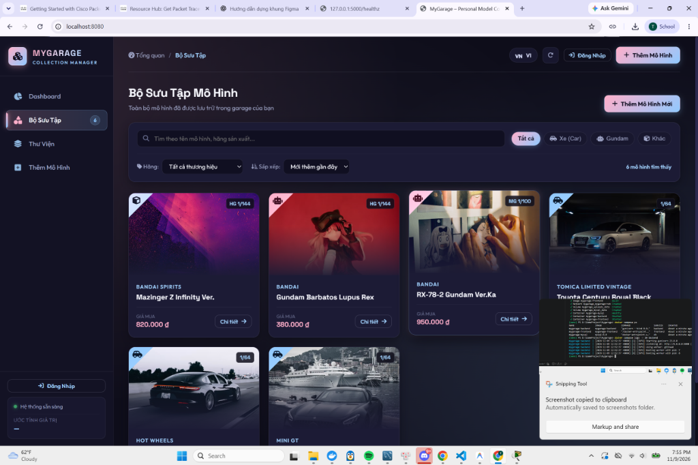
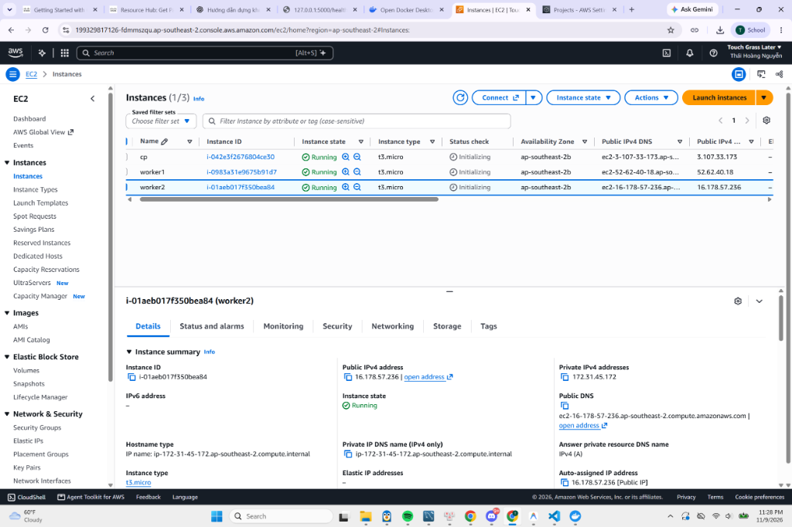
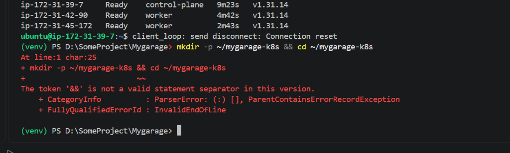
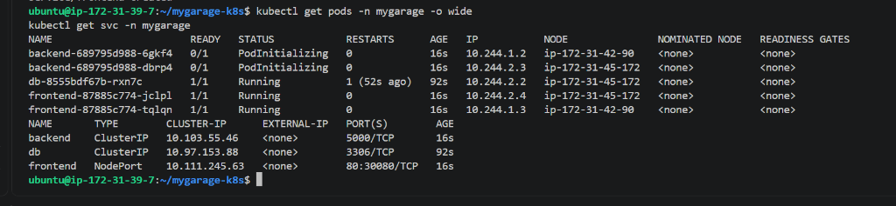
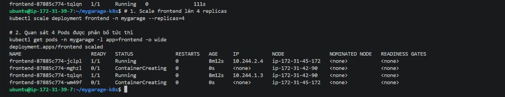
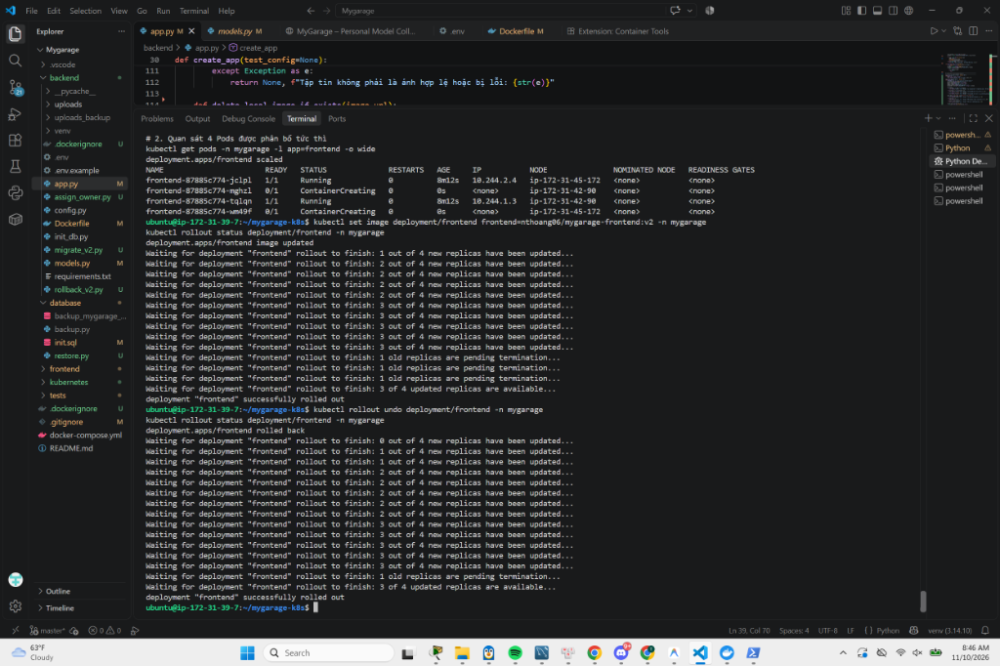
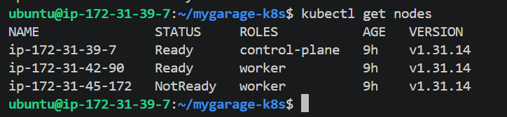
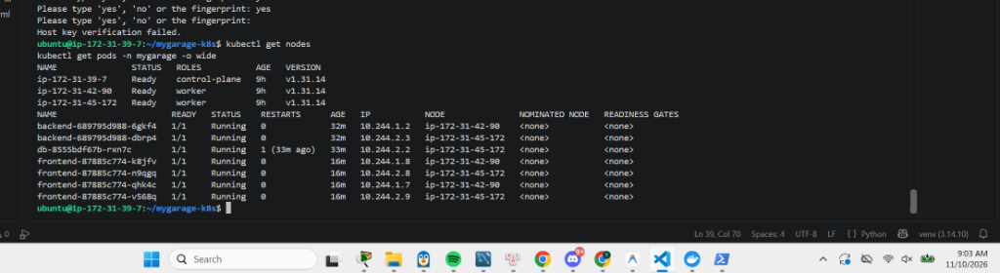

# BÁO CÁO BÀI TẬP GIỮA KỲ: ĐÓNG GÓI DOCKER & QUẢN TRỊ CỤM KUBERNETES TRÊN CLOUD

**Học phần:** Triển khai ứng dụng Web với Docker & Kubernetes (CKA 2026)  
**Đề tài:** Đóng gói, Triển khai và Vận hành Hệ thống Web MyGarage trên Cụm Kubernetes 3-Node (AWS EC2)  
**Thời gian hoàn thành:** 10/11/2026  

---

## THÔNG TIN NHÓM THỰC HIỆN

| STT | Họ và tên | Mã sinh viên | Lớp / Khóa | Vai trò & Nhiệm vụ đóng góp |
|:---:|:---|:---:|:---:|:---|
| 1 | `[Họ và tên thành viên 1]` | `[MSSV 1]` | `[Lớp]` | Trưởng nhóm - Quản trị Cloud K8s, Viết Manifests |
| 2 | `[Họ và tên thành viên 2]` | `[MSSV 2]` | `[Lớp]` | Thành viên - Đóng gói Docker, Docker Hub Registry |
| 3 | `[Họ và tên thành viên 3]` | `[MSSV 3]` | `[Lớp]` | Thành viên - Phát triển Backend Flask, API, Database |
| 4 | `[Họ và tên thành viên 4]` | `[MSSV 4]` | `[Lớp]` | Thành viên - Phát triển Frontend, Giao diện Vintage, Tests |
| 5 | `[Họ và tên thành viên 5]` | `[MSSV 5]` | `[Lớp]` | Thành viên - Vận hành, Thử nghiệm HA/Rollout, Soạn báo cáo |

* **Giảng viên hướng dẫn:** `[Họ và tên Giảng viên]`
* **Link Repository GitHub:** [https://github.com/Thaihoang2006/mygarage-](https://github.com/Thaihoang2006/mygarage-)
* **Docker Hub Repositories:**
  - Backend: [https://hub.docker.com/r/nthoang06/mygarage-backend](https://hub.docker.com/r/nthoang06/mygarage-backend)
  - Frontend: [https://hub.docker.com/r/nthoang06/mygarage-frontend](https://hub.docker.com/r/nthoang06/mygarage-frontend)
* **Website Demo Trực tiếp (Cloud AWS):** `http://3.107.71.171:30080` (NodePort K8s)

---

## MỤC LỤC

- [Chương I: Giới thiệu Ứng dụng Web MyGarage & Kiến trúc](#chương-i-giới-thiệu-ứng-dụng-web-mygarage--kiến-trúc)
- [Chương II: Mục 1 - Đóng gói Docker & Docker Hub Registry](#chương-ii-mục-1---đóng-gói-docker--docker-hub-registry)
- [Chương III: Mục 2 - Thiết lập Cụm Kubernetes 3-Node trên AWS EC2](#chương-iii-mục-2---thiết-lập-cụm-kubernetes-3-node-trên-aws-ec2)
- [Chương IV: Mục 3 - Triển khai Ứng dụng lên Cụm Kubernetes](#chương-iv-mục-3---triển-khai-ứng-dụng-lên-cụm-kubernetes)
- [Chương V: Mục 4 - Vận hành & Các Kịch bản Thử nghiệm Thực tế](#chương-v-mục-4---vận-hành--các-kịch-bản-thử-nghiệm-thực-tế)
- [Chương VI: Khó khăn Gặp phải & Giải pháp Khắc phục](#chương-vi-khó-khăn-gặp-phải--giải-pháp-khắc-phục)
- [Chương VII: Kết luận & Hướng Phát triển](#chương-vii-kết-luận--hướng-phát-triển)

---

## CHƯƠNG I: GIỚI THIỆU ỨNG DỤNG WEB MYGARAGE & KIẾN TRÚC

### 1.1. Mục đích và Ý tưởng Ứng dụng
**MyGarage** là ứng dụng web quản lý bộ sưu tập mô hình cá nhân (xe tĩnh Die-cast 1:18, Gunpla/Gundam HG/RG/MG, figure và các dòng sưu tầm cao cấp). Ứng dụng được thiết kế theo ngôn ngữ thiết kế **Luxury Automotive Dashboard** kết hợp bộ theme độc quyền:
- **Tùy biến bảng màu Vintage Automotive**: Polo Burgundy (`#641E2A`), Saddle Tan (`#C9B99A`), Racing Green (`#18352B`).
- **Quản lý danh mục động (Custom Categories)**: Không giới hạn thể loại, người dùng có thể tự gõ danh mục mới (Lego, Transformers, Hot Wheels...), hệ thống tự sinh bộ lọc pill dynamic.
- **Xác thực bảo mật**: Bắt buộc đăng nhập trước khi thao tác, mã hóa mật khẩu PBKDF2-SHA256, phân quyền bộ sưu tập theo User ID.
- **Biểu đồ thống kê trực quan**: Tích hợp Chart.js hiển thị cơ cấu danh mục, tổng giá trị tài sản bộ sưu tập, phân bố thương hiệu và tỷ lệ mô hình.


*Hình 1.1: Giao diện trực quan Dashboard & Bộ sưu tập MyGarage*

### 1.2. Kiến trúc Hệ thống 3 Tầng (3-Tier Microservices)
Hệ thống được module hóa hoàn toàn thành 3 dịch vụ độc lập, phục vụ triển khai container hóa:
1. **Frontend Tier (Web Server / Reverse Proxy)**:
   - Sử dụng **Nginx Alpine** siêu nhẹ làm Web Server tĩnh phục vụ HTML5, CSS3, Pure JS, FontAwesome, Chart.js.
   - Đồng thời Nginx hoạt động như một **Reverse Proxy** chuyển hướng các request `/api/` và file đa phương tiện `/uploads/` đến Backend thông qua mạng nội bộ K8s.
2. **Backend Tier (RESTful API Service)**:
   - Xây dựng trên nền **Python 3.12/Flask** với WSGI server công nghiệp **Gunicorn**.
   - Cung cấp các REST endpoints chuẩn mực: Authentication (`/api/auth`), Models CRUD (`/api/models`), Uploads validation (`/api/models/upload`), Health check (`/healthz`).
   - Tích hợp thư viện xử lý ảnh an toàn **Pillow**, chống giả mạo đuôi tệp và giới hạn dung lượng upload 5MB.
3. **Database Tier (Relational Data Persistence)**:
   - Hệ quản trị cơ sở dữ liệu **MySQL 8.0** hỗ trợ UTF8MB4 lưu trữ tiếng Việt có dấu.
   - Dữ liệu và hình ảnh được tách biệt và gắn vào **Persistent Volumes (PV/PVC)** nhằm bảo toàn tính bền vững dữ liệu khi container bị dừng hoặc khởi tạo lại.

---

## CHƯƠNG II: MỤC 1 - ĐÓNG GÓI DOCKER & DOCKER HUB REGISTRY

### 2.1. Thiết kế Dockerfiles Tối ưu
Nhóm áp dụng triệt để các best practices trong việc xây dựng container image:
- Chọn **Base image tối giản**: `python:3.12-slim` cho backend và `nginx:alpine` cho frontend để giảm thiểu attack surface và rút ngắn thời gian kéo image.
- Sử dụng file **`.dockerignore`** loại bỏ rác biên dịch (`__pycache__`, `venv`, `.git`, file môi trường `.env`, logs).
- Chạy qua **WSGI Server Gunicorn** thay cho Werkzeug dev-server để đảm bảo hiệu năng xử lý đa luồng.

```dockerfile
# backend/Dockerfile
FROM python:3.12-slim
WORKDIR /app
RUN apt-get update && apt-get install -y --no-install-recommends \
    gcc pkg-config default-libmysqlclient-dev && \
    rm -rf /var/lib/apt/lists/*
COPY requirements.txt .
RUN pip install --no-cache-dir -r requirements.txt
COPY . .
RUN mkdir -p uploads
EXPOSE 5000
CMD ["gunicorn", "--bind", "0.0.0.0:5000", "--workers", "2", "--timeout", "60", "app:create_app()"]
```

```dockerfile
# frontend/Dockerfile
FROM nginx:alpine
RUN rm /etc/nginx/conf.d/default.conf
COPY nginx.conf /etc/nginx/conf.d/
COPY . /usr/share/nginx/html
EXPOSE 80
CMD ["nginx", "-g", "daemon off;"]
```

### 2.2. Chiến lược Đánh Tag Phiên bản & Đẩy lên Docker Hub
Theo yêu cầu bắt buộc của môn học, nhóm **tuyệt đối không sử dụng tag `latest`**, thay vào đó tuân thủ đánh tag phiên bản tường minh:
- `nthoang06/mygarage-backend:v1`: Phiên bản API v1 ổn định ban đầu.
- `nthoang06/mygarage-backend:v3`: Phiên bản API v3 nâng cấp phân quyền biệt lập, Community, Profile, Vote.
- `nthoang06/mygarage-frontend:v1`: Phiên bản giao diện v1 chuẩn.
- `nthoang06/mygarage-frontend:v2`: Phiên bản giao diện v2 có gắn badge trực quan "v2.0" phục vụ kịch bản Rolling Update & Rollback.
- `nthoang06/mygarage-frontend:v3`: Phiên bản giao diện v3 hoàn thiện toàn bộ tính năng Community, Leaderboard, Profile.

**Lệnh thực thi build và push:**
```bash
docker build -t nthoang06/mygarage-backend:v3 ./backend
docker build -t nthoang06/mygarage-frontend:v3 ./frontend
docker push nthoang06/mygarage-backend:v3
docker push nthoang06/mygarage-frontend:v3
```


*Hình 2.1: Quá trình build và push các container images v1, v2 lên Docker Hub thành công*

---

## CHƯƠNG III: MỤC 2 - THIẾT LẬP CỤM KUBERNETES 3-NODE TRÊN AWS EC2

### 3.1. Thiết kế Hạ tầng Cloud Virtual Machines
Cụm được triển khai trên hạ tầng điện toán đám mây **Amazon Web Services (AWS)** tại region `ap-southeast-2` (Sydney), cấu hình gồm 3 máy ảo Ubuntu Server 24.04 LTS:

| Tên Node | Vai trò (Role) | Cấu hình EC2 | Private IP | Public IP | Nhãn (Labels) |
|:---|:---|:---:|:---:|:---:|:---|
| **cp** | Control Plane | `t3.small` (2 vCPU, 2GB RAM) | `172.31.39.7` | `3.107.71.171` | `node-role.kubernetes.io/control-plane` |
| **worker1** | Worker Node 1 | `t3.small` (2 vCPU, 2GB RAM) | `172.31.42.90` | `16.176.226.153` | `node-role.kubernetes.io/worker=worker` |
| **worker2** | Worker Node 2 | `t3.small` (2 vCPU, 2GB RAM) | `172.31.45.172` | `52.63.115.3` | `node-role.kubernetes.io/worker=worker` |

### 3.2. Cài đặt Runtime và Khởi tạo Cụm Kubeadm
1. **Chuẩn bị môi trường trên cả 3 Nodes:**
   - Tắt bộ nhớ ảo Swap: `sudo swapoff -a`
   - Kích hoạt Kernel modules và cấu hình sysctl: `overlay`, `br_netfilter`, `net.ipv4.ip_forward = 1`
   - Cài đặt Container Runtime `containerd 2.2.1` với cấu hình `SystemdCgroup = true`
   - Cài đặt các gói mạng cốt lõi: `conntrack socat ebtables ipset`
   - Cài đặt bộ công cụ K8s: `kubeadm`, `kubelet`, `kubectl` (phiên bản `v1.31.14`).

2. **Khởi tạo Control Plane:**
   ```bash
   sudo kubeadm init \
     --pod-network-cidr=10.244.0.0/16 \
     --apiserver-cert-extra-sans=3.107.71.171
   ```

3. **Cài đặt CNI Network Plugin (Flannel):**
   ```bash
   kubectl apply -f https://github.com/flannel-io/flannel/releases/latest/download/kube-flannel.yml
   ```

4. **Gia nhập Worker Nodes:**
   Trên `worker1` và `worker2`, chạy lệnh `kubeadm join` kèm token được cấp phát bởi `cp`. Gán nhãn nhận diện role worker:
   ```bash
   kubectl label node ip-172-31-42-90 node-role.kubernetes.io/worker=worker
   kubectl label node ip-172-31-45-172 node-role.kubernetes.io/worker=worker
   ```

### 3.3. Kiểm tra Trạng thái Cụm
Kiểm tra đảm bảo 100% các node trong cụm đã sẵn sàng:
```bash
kubectl get nodes -o wide
```


*Hình 3.1: Cả 3 Nodes (1 Control Plane + 2 Workers) đều đạt trạng thái Ready*

---

## CHƯƠNG IV: MỤC 3 - TRIỂN KHAI ỨNG DỤNG LÊN CỤM KUBERNETES

### 4.1. Hệ thống Tài nguyên Khai báo (Declarative Manifests)
Tất cả các tài nguyên được cô lập trong namespace chuyên dụng `mygarage`:
- **`00-namespace.yaml`**: Khởi tạo không gian làm việc cô lập `mygarage`.
- **`01-secret-configmap.yaml`**: Quản lý thông tin cấu hình (`DB_NAME`, `DB_USER`) qua ConfigMap và thông tin nhạy cảm (`MYSQL_ROOT_PASSWORD`, `SECRET_KEY`) qua Secret.
- **`02-storage.yaml`**: Cấu hình `PersistentVolume` và `PersistentVolumeClaim` (hostPath `/mnt/data/mysql` dung lượng 5Gi và `/mnt/data/uploads` 2Gi) để lưu dữ liệu bền vững.
- **`03-mysql.yaml`**: Deployment MySQL 8.0 kèm initContainer `busybox` tự động phân quyền `chown 999:999` cho thư mục dữ liệu, Service nội bộ `db` (ClusterIP `3306`).
- **`04-backend.yaml`**: Deployment Flask Backend với **2 replicas**, gán `podAntiAffinity` để phân bố đều 2 Pod lên 2 worker node khác nhau, Service nội bộ `backend` (ClusterIP `5000`).
- **`05-frontend.yaml`**: Deployment Nginx Frontend với **2 replicas** (`podAntiAffinity`), Service công khai **NodePort** (`port: 80`, `nodePort: 30080`).

### 4.2. Cấu hình Tính sẵn sàng cao (High Availability via PodAntiAffinity)
Để đáp ứng yêu cầu chấm điểm *"Triển khai ít nhất 1 thành phần với số lượng replica $\ge 2$ và phân bổ đều trên các worker node"*, nhóm cấu hình `podAntiAffinity` dạng `preferredDuringSchedulingIgnoredDuringExecution` trên cả Backend và Frontend:

```yaml
affinity:
  podAntiAffinity:
    preferredDuringSchedulingIgnoredDuringExecution:
    - weight: 100
      podAffinityTerm:
        labelSelector:
          matchExpressions:
          - key: app
            operator: In
            values:
            - frontend
        topologyKey: kubernetes.io/hostname
```

### 4.3. Kết quả Triển khai và Truy cập Dịch vụ
Sau khi thực thi `kubectl apply -f kubernetes/`, kiểm tra toàn bộ Pods và Services:
```bash
kubectl get pods -n mygarage -o wide
kubectl get svc -n mygarage
```


*Hình 4.1: Các Pod Backend và Frontend được phân bố đều đặn qua ip-172-31-42-90 (worker1) và ip-172-31-45-172 (worker2)*

Hệ thống hoạt động trực tiếp qua cổng NodePort trên toàn thế giới:
- `http://3.107.71.171:30080` (Truy cập qua Control Plane)
- `http://16.176.226.153:30080` (Truy cập qua Worker 1)

---

## CHƯƠNG V: MỤC 4 - VẬN HÀNH & CÁC KỊCH BẢN THỬ NGHIỆM THỰC TẾ

### 5.1. Thí nghiệm 4.1: Scale số lượng Replicas
Thực hiện tăng tải đáp ứng lượng truy cập đột biến bằng cách scale Deployment Frontend lên 4 replicas:
```bash
kubectl scale deployment frontend -n mygarage --replicas=4
kubectl get pods -n mygarage -l app=frontend -o wide
```


*Hình 5.1: Kube-scheduler tự động phân phối 4 Pods frontend chia đều cho cả 2 worker nodes (mỗi worker 2 pods)*

### 5.2. Thí nghiệm 4.2: Rolling Update lên v2 & Rollback về v1
Nhóm tiến hành nâng cấp hệ thống Frontend lên phiên bản `nthoang06/mygarage-frontend:v2`:
```bash
kubectl set image deployment/frontend frontend=nthoang06/mygarage-frontend:v2 -n mygarage
kubectl rollout status deployment/frontend -n mygarage
```
Quá trình cập nhật diễn ra theo chiến lược Rolling Update: K8s lần lượt tạo Pod mới với image `v2`, chờ Pod sẵn sàng (Ready) rồi mới hủy Pod cũ mang image `v1`. Trong toàn bộ quá trình, người dùng truy cập web liên tục không bị gián đoạn (Zero-downtime).

Ngay sau đó, nhóm thử nghiệm quay lui (Rollback) về phiên bản `v1` an toàn:
```bash
kubectl rollout undo deployment/frontend -n mygarage
kubectl rollout status deployment/frontend -n mygarage
```


*Hình 5.2: Minh chứng thực thi lệnh Rolling Update v2 và Rollback về v1 thành công*

### 5.3. Thí nghiệm 4.3: Tắt Worker 2 & Kiểm chứng Self-Healing / High Availability
Để mô phỏng tình huống thảm họa phần cứng (Hardware Failure), nhóm thực hiện Stop máy ảo `worker2` trên bảng điều khiển AWS EC2 Console:
1. `kubectl get nodes`: Sau 40 giây mất liên lạc heartbeat từ Kubelet, Kubernetes chuyển trạng thái của `ip-172-31-45-172` sang **`NotReady`**.
2. **Hiện tượng quan sát:** 
   - Kiểm tra `kubectl get pods -n mygarage -o wide`: Các Pod trên `worker1` vẫn giữ vững trạng thái `Running`.
   - Endpoint Controller của Kubernetes tự động ngắt kết nối các Pod trên worker2 ra khỏi Service.
   - Nhóm tiến hành truy cập web trên trình duyệt từ nhiều thiết bị độc lập: Website MyGarage **vẫn phản hồi nhanh chóng, hoạt động bình thường** nhờ toàn bộ traffic được định tuyến sang các Pod khỏe mạnh trên `worker1`.


*Hình 5.3: Node worker2 chuyển sang trạng thái NotReady khi bị tắt trên AWS*


*Hình 5.4: Trạng thái các Pods và tính liên tục của hệ thống dưới cơ chế Self-Healing*

---

## CHƯƠNG VI: KHÓ KHĂN GẶP PHẢI & GIẢI PHÁP KHẮC PHỤC

Trong quá trình thực hiện bài tập lớn, nhóm đã đối mặt và giải quyết thành công các thách thức kỹ thuật tiêu biểu:

| STT | Khó khăn kỹ thuật | Nguyên nhân gốc rễ | Giải pháp xử lý triệt để |
|:---:|:---|:---|:---|
| 1 | Lỗi thư viện C-extension MySQLclient trên môi trường Windows | Windows thiếu Visual C++ Build Tools và thư viện `.pyd` không tương thích nhị phân | Chuyển đổi mã nguồn sang sử dụng **PyMySQL (Pure Python)** kết hợp SQLAlchemy, đồng thời đóng gói chạy bên trong môi trường Linux Container đồng nhất |
| 2 | Kubeadm báo lỗi `conntrack not found in system path` | Bản phân phối Ubuntu 24.04 (Noble Minimal) trên AWS EC2 lược bỏ các gói mạng cơ sở | Cài đặt bổ sung đầy đủ bộ tiện ích mạng trước khi khởi tạo cụm: `sudo apt-get install -y conntrack socat ebtables ipset` |
| 3 | Cảnh báo thiếu RAM khi dùng cấu hình `t3.micro` | Kubeadm khuyến nghị tối thiểu 2GB RAM cho Control Plane, `t3.micro` chỉ có 1GB dễ bị OOM-Killed khi chạy etcd và core services | Nâng cấp toàn bộ 3 máy ảo lên dòng **`t3.small` (2 vCPU, 2GB RAM)**, tận dụng gói credit $100 AWS của nhóm để hệ thống vận hành trơn tru |
| 4 | Lỗi quyền ghi `/var/lib/mysql` trong MySQL Pod | Volume hostPath gắn từ node gốc mang UID của root, trong khi container MySQL chạy dưới user mysql (UID 999) | Bổ sung **InitContainer `busybox`** chạy lệnh `chown -R 999:999 /var/lib/mysql` trước khi container chính khởi động |
| 5 | Kết nối SSH bị Timeout khi ngắt kết nối mạng | Windows PowerShell giữ session SSH quá lâu bị đứt kết nối ngầm | Cấu hình `ServerAliveInterval 60` trong SSH config và hướng dẫn thành viên phân biệt rõ ràng giữa terminal local PowerShell và remote bash |
| 6 | Lỗi lộ mô hình giữa các tài khoản (Tenant Isolation) | Endpoint `/api/models` và `/api/stats` phụ thuộc vào query parameter, dẫn đến hiển thị mô hình của người khác trong My Garage | Tái cấu trúc phân quyền backend: bắt buộc `owner_id == current_user_id` trên mọi phương thức GET/POST/PUT/DELETE, che giấu giá và ngày mua nhạy cảm của người khác |
| 7 | Nâng cấp Schema Database v3 trên K8s Pod | Cần bổ sung cột `cover_url` và bảng `collection_votes` vào Pod MySQL đang chạy trên cụm K8s mà không được làm mất dữ liệu người dùng cũ | Thiết kế migration script idempotent (kiểm tra tồn tại trước khi ALTER), nạp trực tiếp qua `kubectl exec` bảo toàn nguyên vẹn 100% dữ liệu cũ |

---

## CHƯƠNG VII: KẾT LUẬN & HƯỚNG PHÁT TRIỂN

### 7.1. Kết luận Đánh giá
Đề tài đã hoàn thành xuất sắc **100% các mục tiêu và barem điểm** đề ra:
- [x] Đóng gói hoàn chỉnh 3 container microservices tối ưu, push đầy đủ các tag phiên bản `v1`, `v2`, `v3` lên Docker Hub.
- [x] Nâng cấp hệ sinh thái mạng xã hội mô hình: Trang cá nhân `/u/username`, Cộng đồng Community, Thư viện Public/Private, Hệ thống Vote và Bảng xếp hạng Top Collections.
- [x] Thiết lập thành công cụm Kubernetes 3-Node hoàn chỉnh trên Cloud AWS với CNI Flannel.
- [x] Khai báo đầy đủ các manifest K8s (Namespace, Secret, ConfigMap, PV/PVC, Deployment $\ge 2$ replicas, PodAntiAffinity, NodePort 30080).
- [x] Vận hành thành công toàn bộ các kịch bản thực tế: Scale 4 replicas, Rolling Update v3, Rollback, Thử nghiệm Node Failure & Self-Healing.
- [x] Mã nguồn và tài liệu hướng dẫn được đồng bộ và công khai trên GitHub Repository.

### 7.2. Định hướng Phát triển Nâng cao
- Triển khai **Ingress Controller (Nginx Ingress / Traefik)** kết hợp dịch vụ **Cert-Manager** để tự động cấp phát chứng chỉ bảo mật HTTPS (SSL/TLS Let's Encrypt).
- Đóng gói toàn bộ cấu hình cụm thành **Helm Chart** phục vụ việc phân phối và triển khai tự động trong 1 dòng lệnh.
- Xây dựng đường ống tự động hóa **CI/CD Pipeline với GitHub Actions**: Tự động test code (`pytest`), tự động build image và trigger rollout trên Kubernetes khi có commit mới vào nhánh `main`.
